  

  
  
  
  

## 👋 About

I build embodied systems that **perceive, plan, and act** — in simulation, on real hardware, and in the browser. My work spans ROS-based manipulation, learning-based UAV navigation, and vision-language-action models.

- 🦾 **Manipulation** — ROS Noetic, MoveIt, Franka Panda
- 🚁 **Autonomy** — YOPO, 3D Tiles, depth estimation
- 🧠 **Robot learning** — VLA fine-tuning, LoRA, imitation learning
- 👁️ **Vision** — monocular depth, MVSNet, CNN classification

## 🚀 Featured Work

  
  

  
  

  
  

  More: <a href="https://github.com/wuuwuu26/ai-nav">ai-nav</a> · <a href="https://github.com/wuuwuu26/robotics-practice-labs">robotics-practice-labs</a>

## 🧰 Toolbox

**Languages**  

**Robotics**  

**Learning & Vision**  

**Web & Runtime**  

## 🔭 Currently

- Fine-tuning vision-language-action models for robotic manipulation.
- Exploring learning-based UAV navigation in photorealistic 3D environments.
- Turning course projects into reproducible, open-source demos.

  Perception → Planning → Action · Always building.

